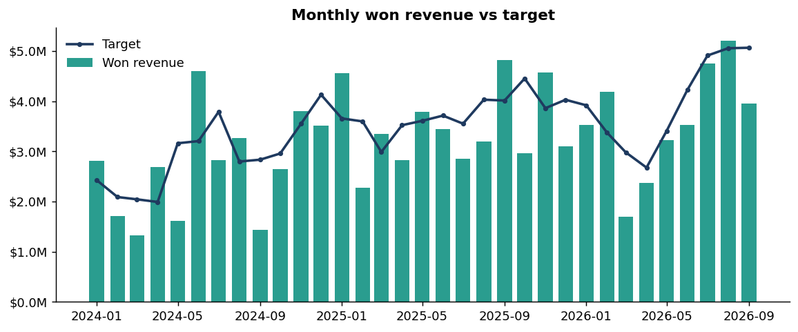
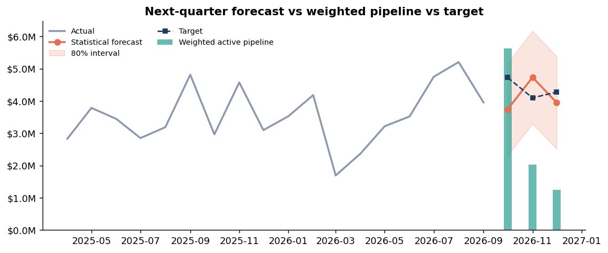
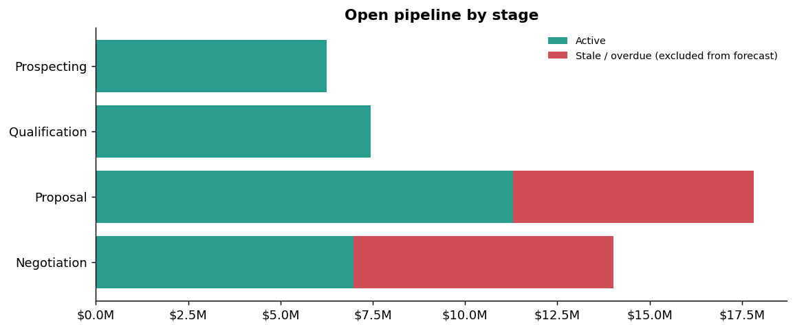
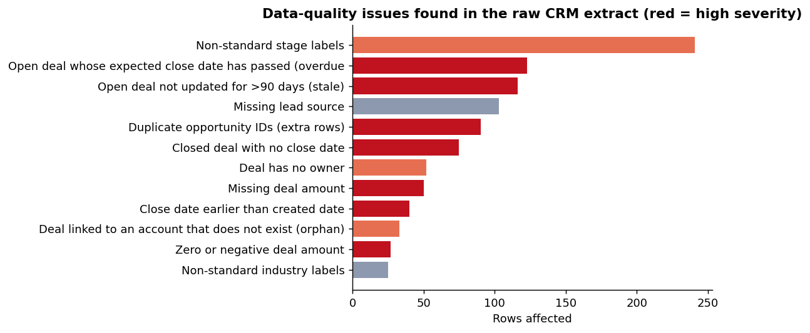
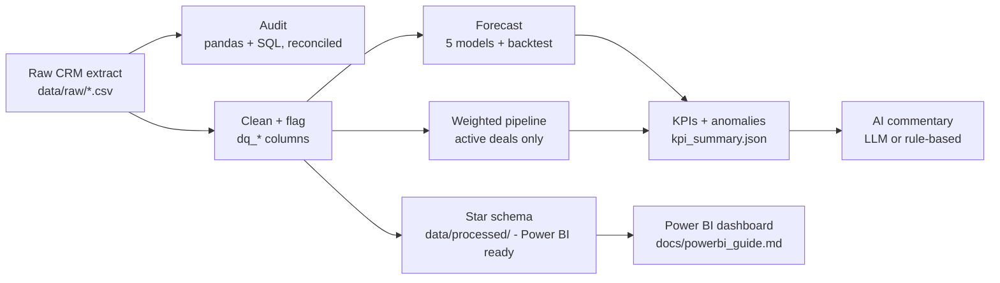

# Sales Pipeline Forecast & CRM Data-Quality Analytics

An end-to-end sales-operations analytics project: **audit a messy CRM extract, clean it, forecast revenue, monitor the pipeline, and generate AI-assisted performance commentary.** It is built around the day-to-day work of a Sales Operations Analyst: pipeline and revenue analysis, CRM data quality, forecasting, reporting, and applying AI to routine reporting.

> **Data note:** all data is **synthetic** (generated by `src/generate_data.py` with a fixed seed). The business is modelled on a two-way-radio and telecommunications integrator, with realistic CRM problems deliberately injected. No real company or customer data is used. Results demonstrate the *method*, not any real business.

---

## What this project answers

| Business question | How it is answered | Output |
|---|---|---|
| Can we trust the CRM data? | 12 data-quality checks, implemented twice (pandas **and** SQL) and reconciled | `reports/data_quality_report.md` |
| How much revenue will we win next quarter? | 5 forecasting models, compared with a rolling-origin backtest | `reports/forecast_next_quarter.csv` |
| Does the open pipeline support that forecast? | Stage-weighted pipeline by expected close month, with stale and overdue deals excluded | `reports/figures/03_forecast.png` |
| Is something going wrong? | Transparent rule-based anomaly detection on the KPIs | `reports/kpi_summary.json` |
| What should managers read this week? | Plain-English commentary written by an LLM from pre-computed numbers (or a rule-based fallback) | `reports/sales_commentary.md` |

## Key results (from the included synthetic data)

- **3,432 raw rows -> 3,342 clean rows.** 12 issue types found; the audit flagged 241 non-standard stage labels, 90 duplicate IDs, 75 closed deals with no close date, 116 stale open deals and 123 overdue open deals.
- **~30% of open pipeline value ($13.6M of $45.5M) is stale or overdue** and is excluded from the forecast, so a naive "sum the pipeline" figure would be materially overstated.
- **Forecast accuracy is honest, not flattering:** monthly B2B revenue is lumpy. In the 9-month backtest the best models reach a weighted MAPE of about **26%**, and the seasonal model does *worse* than a simple moving average. The project reports this rather than hiding it (see "Methodology").
- **Forecast next month (Oct 2026): $3.7M** (80% range $2.3M to $5.2M) vs a $4.7M target.






---

## Architecture



## Quick start

```bash
git clone <your-repo-url>
cd sales-pipeline-forecast-ai
python -m venv .venv && source .venv/bin/activate     # Windows: .venv\Scripts\activate
pip install -r requirements.txt

python -m src.run_pipeline --no-llm      # runs everything in a few seconds
pytest                                    # 16 tests
```

The repository already contains generated outputs, so you can browse results without running anything.

**Optional - LLM-written commentary.** Set `ANTHROPIC_API_KEY` in your environment and run `python -m src.run_pipeline`. The model receives only the pre-computed KPI JSON. Without a key, or if the call fails, the project falls back to a deterministic rule-based writer and still completes.

**Use your own data.** Replace the files in `data/raw/` with real exports using the same column names, then run `python -m src.run_pipeline`. Use `--regenerate` to rebuild the synthetic data.

## Project structure

```
src/
  config.py          Business rules and settings (stale threshold, stage probabilities, horizons)
  generate_data.py   Synthetic CRM generator with injected data-quality problems
  data_quality.py    12 checks in pandas + SQL runner + reconciliation + report writer
  cleaning.py        Cleaning rules; every repair is flagged with a dq_* column
  forecast.py        Models, rolling-origin backtest, weighted pipeline
  kpis.py            KPI summary and anomaly rules
  ai_commentary.py   LLM commentary with a rule-based fallback
  visuals.py         Charts
  run_pipeline.py    Orchestrates everything
sql/data_quality_checks.sql   The same 12 checks in SQL
tests/                        16 automated tests
docs/powerbi_guide.md         Data model, DAX measures and page layout for Power BI
data/raw/                     Messy CRM extract (synthetic)
data/processed/               Clean star schema (fact + dimension tables)
reports/                      Audit, forecast, KPI summary, commentary, figures
```

## Methodology

**1. Data-quality audit.** Twelve checks (duplicates, bad labels, missing or invalid amounts, impossible dates, orphan accounts, stale and overdue open deals...). The SQL and pandas implementations are independent, and the pipeline compares them on every run; a test fails if they disagree.

**2. Cleaning without silent changes.** Duplicates keep the latest record. Invalid amounts become null (excluded from revenue maths, never guessed). Closed deals with a missing or impossible close date are imputed from the last-modified date and flagged. Open deals with an untrustworthy close date are blanked. Orphan accounts map to an "Unknown" member so the star schema keeps referential integrity.

**3. Forecasting.** Monthly won revenue is forecast with five models: naive, 3-month moving average, seasonal naive, trend + month-of-year regression, and an ensemble of three. A **rolling-origin backtest** forecasts each of the last 9 months using only data available at that time. A test proves that changing the latest data point cannot alter any backtest forecast (no leakage). Prediction intervals use the chosen model's backtest RMSE.

**Model selection rule (documented, not hidden):** the lowest-error model wins, *except* that the ensemble is preferred when within 1 WMAPE point of the best, because with only nine test months small gaps are noise and averaging is more robust. Here the ensemble was used (25.9% vs 25.7% for the best single model).

**4. Weighted pipeline.** Open amount x stage probability, grouped by expected close month, using **active** deals only (not stale, not overdue, valid amount and date). The pipeline-implied win rate is compared with the historical value-based win rate to flag over-optimistic stage probabilities.

**5. AI commentary with a guardrail.** All figures and anomalies are computed in Python. The LLM only narrates a JSON summary and is instructed to use no other numbers, so it cannot invent statistics.

## Limitations (read before relying on any number)

- **Synthetic data.** The structure and messiness are realistic, but conclusions about "this business" are illustrative only.
- **Small sample for model selection.** 33 months of history and a 9-month backtest are enough to compare methods but not to separate close models with confidence.
- **The weighted pipeline is not backtested.** That requires historical snapshots of the open pipeline, which a single CRM extract does not contain. Taking monthly snapshots is the recommended next step.
- **Stage probabilities are assumptions** (`config.py`), not learned from history. The synthetic generator has no stage-dependent win behaviour, so calibrating them against it would be circular.
- **The Power BI report is not included as a `.pbix`.** `data/processed/` and `docs/powerbi_guide.md` give everything needed to build it.

## Possible extensions

Monthly pipeline snapshots to backtest the weighted view, probability calibration from stage-history data, forecasting by product or team, hierarchical reconciliation, and scheduling the pipeline (GitHub Actions or cron) with the commentary posted to Slack or email.

## Tech

Python (pandas, NumPy, scikit-learn, matplotlib), SQL (SQLite dialect), Power BI (DAX guide), pytest, GitHub Actions, optional LLM API.

## Licence

MIT - see [LICENSE](LICENSE).
